# Fee Management System on Azure

This is my submission for the Fusion Practice assignment. It is a small college fee system built on Microsoft Azure:

- **Students** can check how much fee they owe and whether it is *Paid*, *Partially Paid* or *Overdue*.
- **Admins** can see the list of students and update fee records, but only if Azure has verified they are an admin.
- **Every morning at 9 AM**, the system emails every student whose fee is overdue.

This was my first project on Azure, so I have written this README in plain language and added screenshots from my own setup.

---

## How it fits together

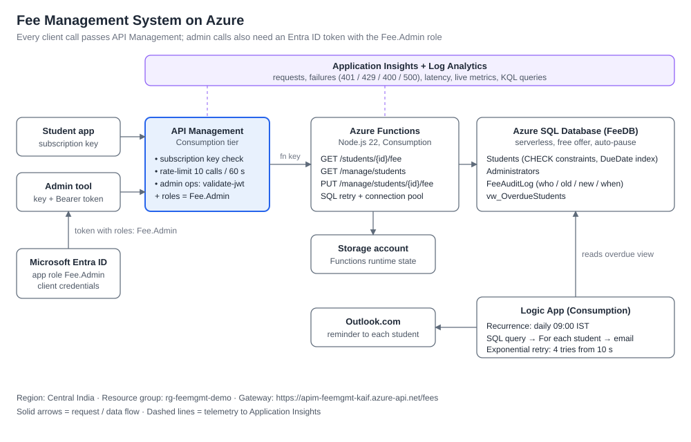

In simple words:

1. A student or admin never talks to the code directly. Every request first goes to **API Management**, which acts as a security guard.
2. API Management checks the **API key**, limits each key to **10 calls per minute**, and for admin requests also checks a **login token from Microsoft Entra ID** that must contain the `Fee.Admin` role.
3. If the checks pass, the request goes to **Azure Functions** (my Node.js code), which reads or updates the **Azure SQL database**.
4. Separately, a **Logic App** runs every morning, finds the overdue students and sends each one an email.
5. **Application Insights** records every request, error and response time, so I can see what is happening.

| Part | Azure service I used | What it does here |
| --- | --- | --- |
| Database | Azure SQL Database (serverless, free offer) | Stores students, admins and an audit log of every change |
| API code | Azure Functions (Node.js, Consumption plan) | Three endpoints: fee lookup, admin list, admin update |
| Security guard | API Management (Consumption tier) | API keys, rate limit, admin token check |
| Login / roles | Microsoft Entra ID (formerly Azure AD) | Defines the `Fee.Admin` role and issues tokens |
| Daily emails | Logic App + Outlook.com | Finds overdue students and emails them, with retries |
| Monitoring | Application Insights | Logs requests, failures and response times |

---

## The five tasks and how I did them

### Task 1: Database

I created an Azure SQL database called **FeeDB** with these tables:

- **Students**: StudentID, Name, Email, Course, TotalFee, PaidAmount, DueDate
- **Administrators**: AdminID, Name, Role
- **FeeAuditLog**: records who changed a fee, when, and the old and new values

I also made a view called **vw_OverdueStudents**, so "overdue" is defined in one place.
I added 20 sample students: 6 Paid, 7 Partially Paid and 7 Overdue.

The assignment's Students table had no Email column, but Task 2 needs to send emails, so I added one.
The database also refuses bad data on its own: a fee cannot be negative, and the paid amount cannot be more than the total fee.

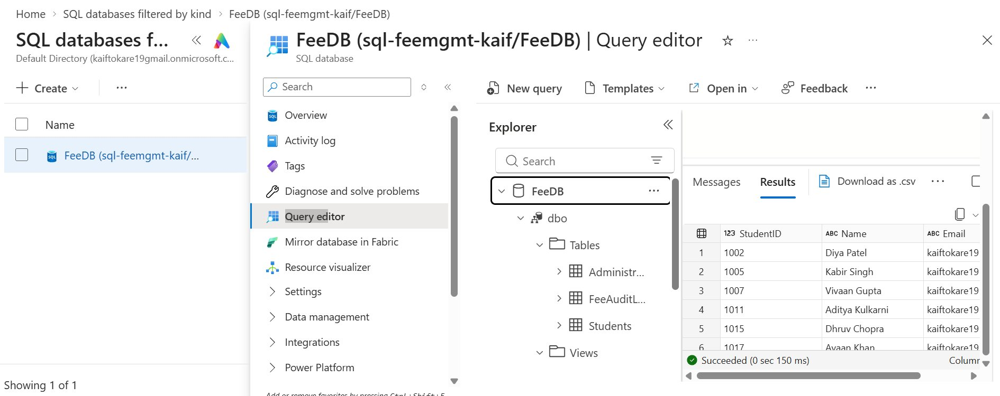

Scripts: [`database/`](database)

### Task 2: Automatic email reminders

I built a **Logic App** that runs every day at 9:00 AM India time:

1. It runs a SQL query on the overdue view.
2. For each overdue student, it sends an email with their name, balance, course and how many days overdue they are.
3. Both the SQL step and the email step **retry 4 times** with growing waits if something fails.

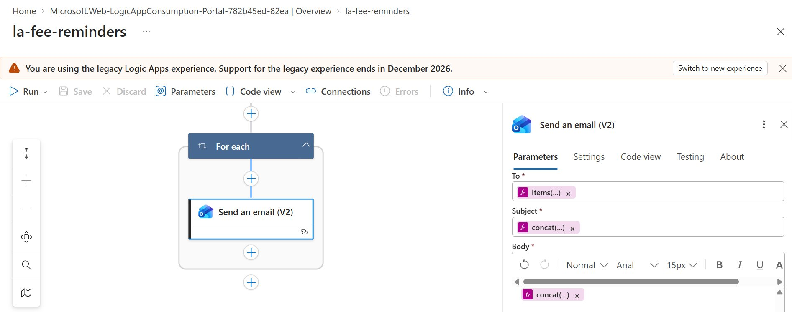

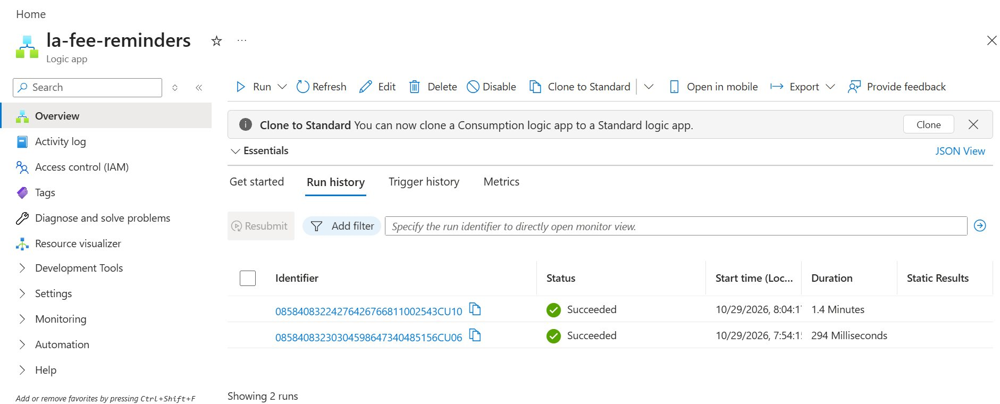

All 7 overdue students got their reminder (I used Gmail "+" addresses so every email came to my own inbox for testing):

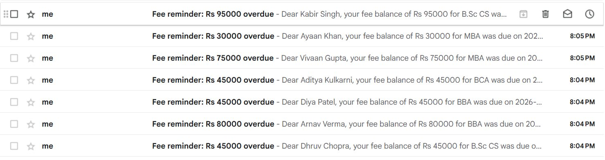

Workflow definition: [`logicapp/fee-reminder-logicapp.json`](logicapp/fee-reminder-logicapp.json)

### Task 3: Payment status API

I wrote an **Azure Function** that takes a StudentID and returns the fee details with a status:

- **Paid**: paid amount is equal to or more than the total fee
- **Overdue**: not fully paid and the due date has passed
- **Partially Paid**: not fully paid, but the due date has not passed yet

The status is worked out every time from the amounts and dates, so it is never out of date.

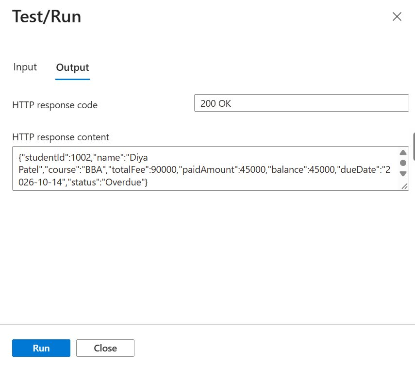

Then I put **API Management** in front of it:

- Every call needs an **API key** (a "subscription key"). I made one key for the student app and one for the admin tool.
- Each key can make **10 calls per minute**. The 11th call gets **429 Too Many Requests**.

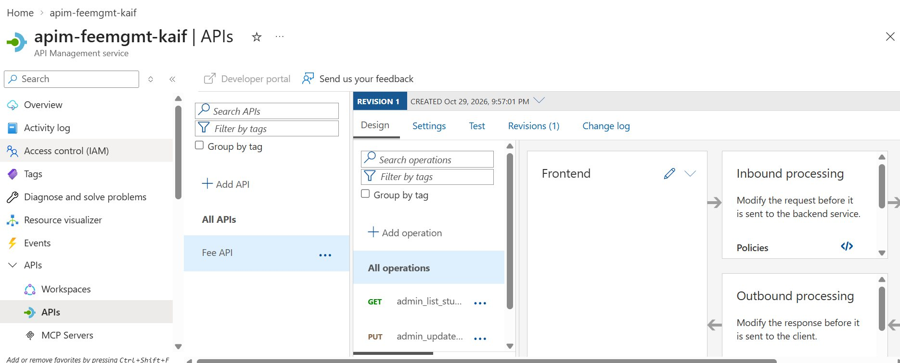

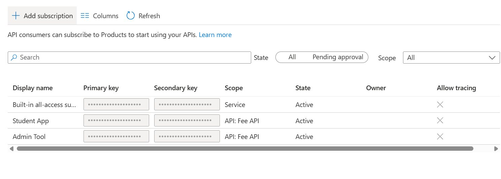

Code: [`functions/src/functions/fees.js`](functions/src/functions/fees.js) · Policy: [`apim/api-policy.xml`](apim/api-policy.xml)

### Task 4: Secure updates for admins

The two admin endpoints (list students, update a fee) need **two things**: an API key **and** a token from Microsoft Entra ID that has the **`Fee.Admin`** role.

How I set it up:

1. I registered the API in Entra ID as **fee-api** and created an app role called **Fee.Admin**.
2. I registered an **admin client app** and gave it the Fee.Admin role (with admin consent).
3. In API Management, I added a `validate-jwt` policy to the admin endpoints. It checks the token's signature, expiry, that it was issued for my API, and that it contains `Fee.Admin`. If anything is missing, the request is blocked with **401** before it reaches my code.
4. API Management also passes the admin app's ID to my function, which saves it in **FeeAuditLog** with every change.

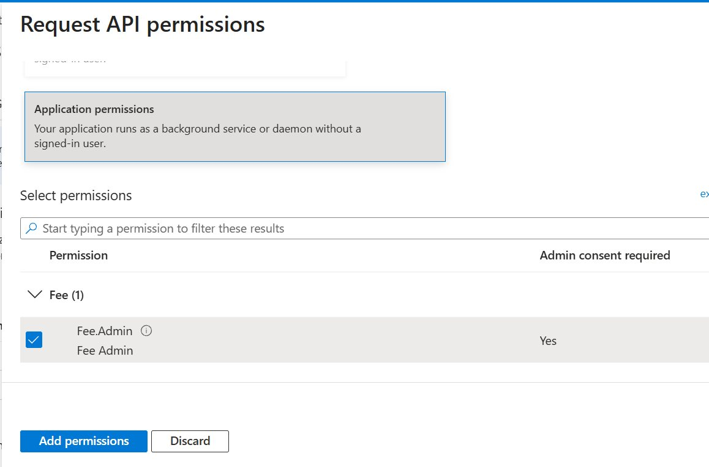

This is what the inside of the admin token looks like (decoded on jwt.ms). The important line is `roles`:

```json
{
  "aud": "cca19e0b-0da0-41ea-8302-b3503e55bcb1",
  "iss": "https://login.microsoftonline.com/019be382-2033-4602-863e-2ff2afa0b0c4/v2.0",
  "azp": "5c882b13-8084-45ee-b845-330e8f024b11",
  "roles": ["Fee.Admin"],
  "ver": "2.0"
}
```

Policy: [`apim/admin-operation-policy.xml`](apim/admin-operation-policy.xml)

### Task 5: Monitoring, retries and 5,000 students

**Monitoring.** I connected both the Function App and API Management to **Application Insights**.
I can see every request, every error and how long each call took.

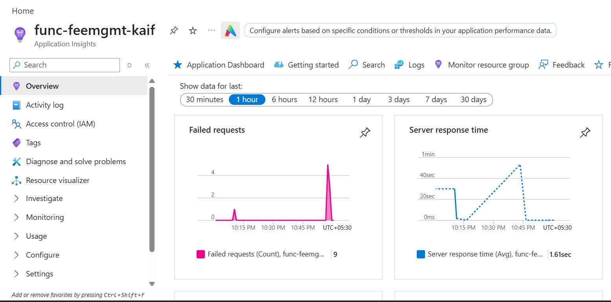

The Failures page shows the security working: **429** (rate limit), **401** (no key or no admin token) and one early **500** (explained below).

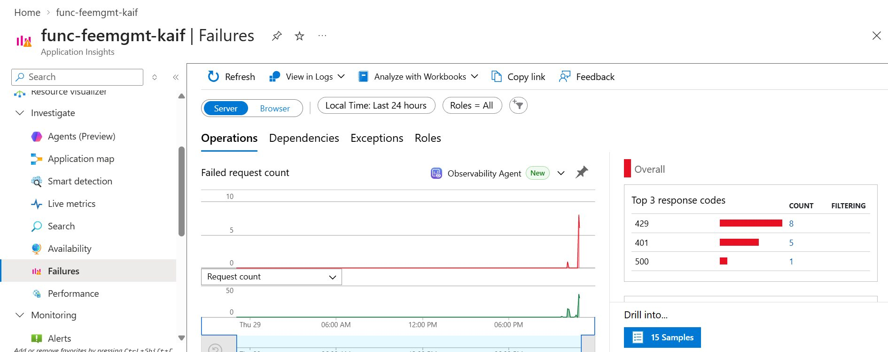

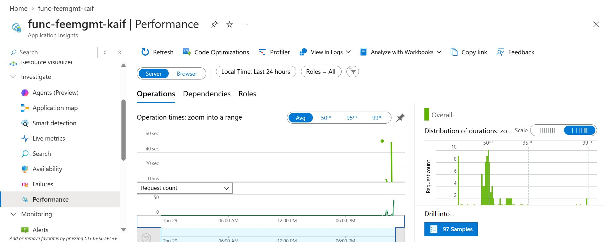

I also wrote a KQL query that breaks every call down by endpoint and result code:

```kusto
requests
| where timestamp > ago(24h)
| summarize calls = count(), avgMs = round(avg(duration), 1), failures = countif(success == false) by cloud_RoleName, name, resultCode
| order by cloud_RoleName, calls desc
```

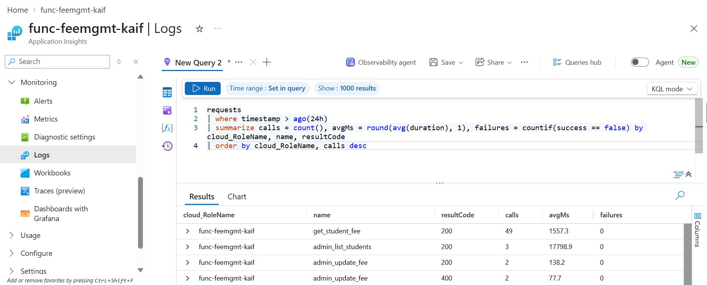

**Retry policies.** The Logic App retries its SQL and email steps 4 times. My function code also retries the database connection
(waiting 2, 4, 8, 16 and 32 seconds) because the free database "sleeps" when nobody uses it and needs a moment to wake up.

**5,000 students.** I added 5,000 extra test students with a script. The lookups and the overdue list stayed fast, because
lookups use the primary key, the overdue search uses an index on DueDate, and the admin list returns at most 200 students per page.
The test students are all due in the future, so no extra emails were sent.

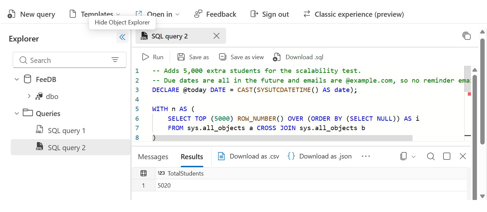

---

## Test results

I wrote three PowerShell test scripts in [`tests/`](tests). They ask for the keys when you run them, so no secrets are saved in the files.

| What I tested | Expected | Result |
| --- | --- | --- |
| Student 1002 with a valid key | 200, status Overdue | ✅ |
| No key / wrong key | 401 | ✅ |
| 15 quick calls with one key | 429 after about 10 calls | ✅ |
| Admin token: list overdue students | 200, 7 students | ✅ |
| Admin token: update a record | 200, saved in FeeAuditLog | ✅ |
| Admin token: pay more than the total fee | 400 | ✅ |
| Admin endpoint with a key but no token | 401 | ✅ |
| Logic App run | 7 emails | ✅ |
| 5,020 students in the table | API still fast | ✅ |

---

## Endpoints

Base URL: `https://apim-feemgmt-kaif.azure-api.net/fees`

| Method | Path | Who can call it |
| --- | --- | --- |
| GET | `/students/{id}/fee` | Anyone with an API key |
| GET | `/manage/students?status=Overdue&page=1&pageSize=50` | API key + Entra token with `Fee.Admin` |
| PUT | `/manage/students/{id}/fee` with body like `{"paidAmount": 90000}` | API key + Entra token with `Fee.Admin` |

---

## Problems I ran into (and how I fixed them)

Being new to Azure, I hit a few real issues. These were the most useful lessons:

| Problem | Why it happened | What I did |
| --- | --- | --- |
| Could not create a "Flex Consumption" Function App | Not allowed on free-trial subscriptions | Used the regular Consumption plan |
| Python was not in the list of languages | That plan on Windows has no Python | Wrote the API in Node.js instead |
| Every API address returned 404 after deploying | The Function App had no storage account setting (`AzureWebJobsStorage`) | Created a storage account, added the setting, redeployed |
| The admin endpoints returned 404 but the student one worked | Azure Functions keeps addresses starting with `admin` for itself | Renamed them to `/manage/...` |
| The first call of the day sometimes failed or took ~30-60 seconds | The free database pauses when idle | Added retries with growing waits in the code |
| Reminder emails went to spam | A Gmail address was sent through Outlook's servers | Fine for testing; in a real system I would use a verified company domain |

---

## What I would improve for a real production system

- Use **managed identity** and **Key Vault** instead of storing the database password in settings.
- Let students **log in**, so each student can only see their own fee record.
- Return **403** (instead of 401) when someone has a valid token but not the admin role.
- Keep the database and storage **private** (private endpoints), and only let API Management reach the Function App.
- Set everything up with **Infrastructure as Code** (Bicep) and deploy through **GitHub Actions**.
- Send emails from a **verified domain** and remember when each reminder was sent, so nobody gets duplicates.

---

## Project layout

```
database/   SQL scripts: tables, overdue view, sample data, 5,000-student test
functions/  The API code (Node.js Azure Functions)
apim/       API Management policies (rate limit, admin token check)
logicapp/   The reminder workflow exported from Azure
tests/      PowerShell scripts to test everything
docs/       Architecture diagram, step-by-step deployment guide, demo script, screenshots
```

**Want to set it up yourself?** Follow [docs/deployment-guide.md](docs/deployment-guide.md). It has every step, in order.

### Running the API on your own computer

1. Install Node.js and Azure Functions Core Tools v4.
2. `cd functions` then `npm install`
3. Copy `local.settings.example.json` to `local.settings.json` and put in your own database connection string.
4. Run `func start`.

`local.settings.json` holds the database password, so it is in `.gitignore` and never uploaded.
